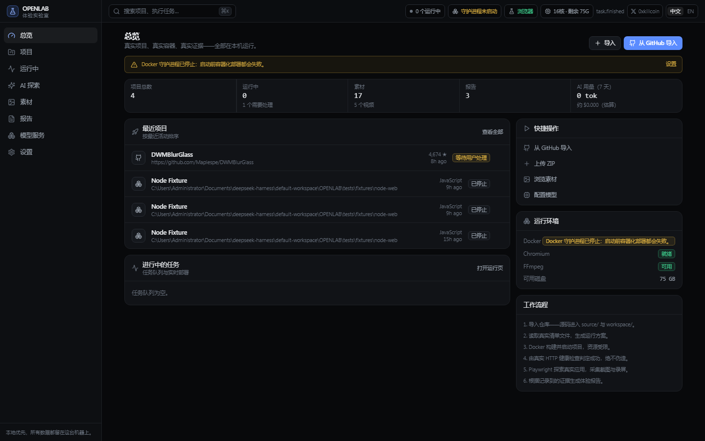
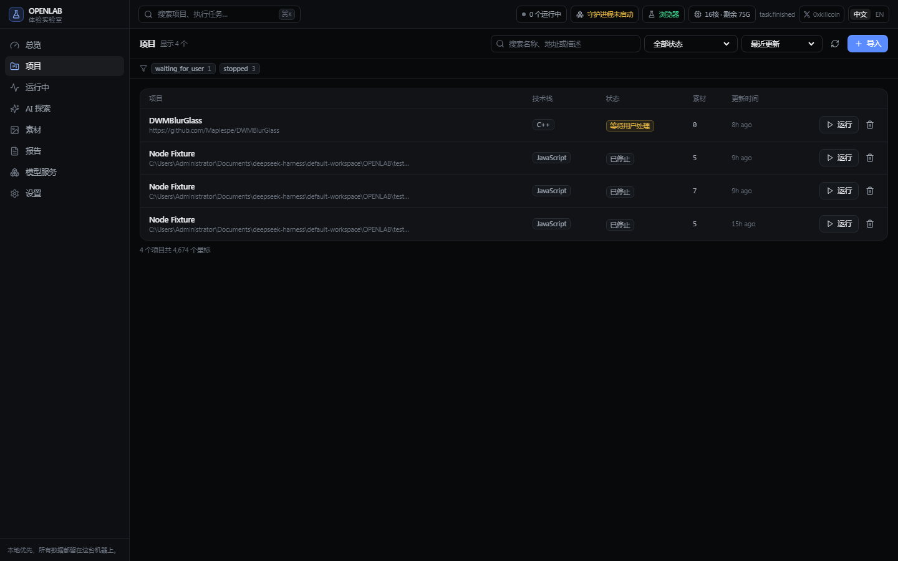
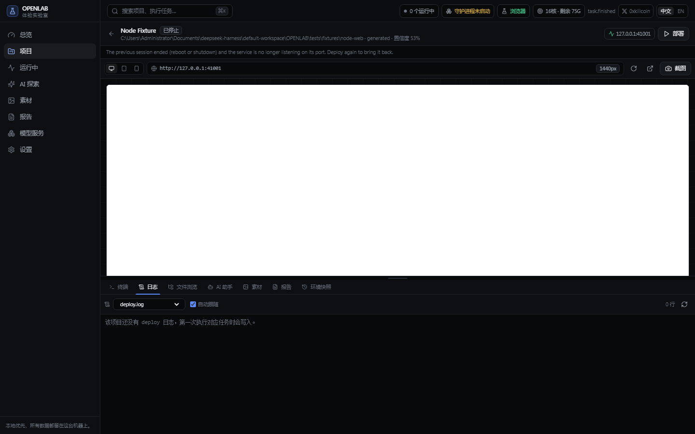
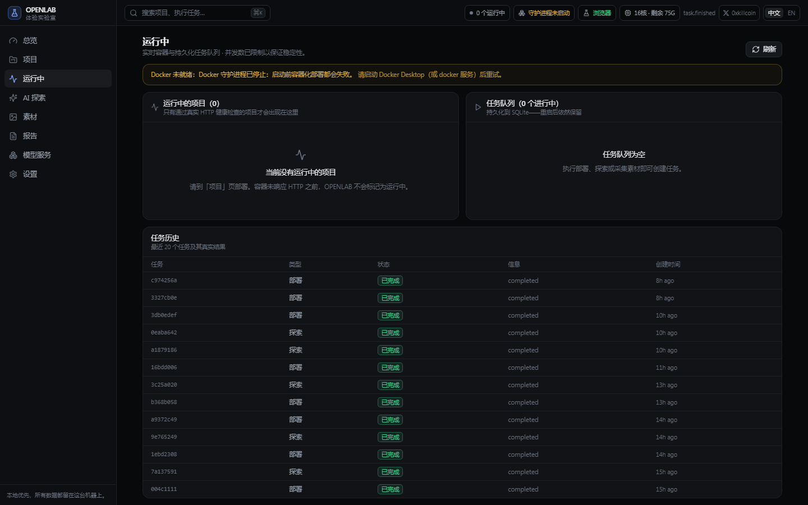
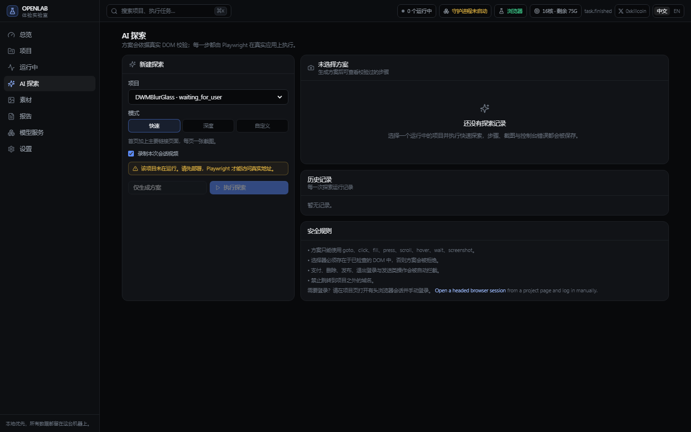
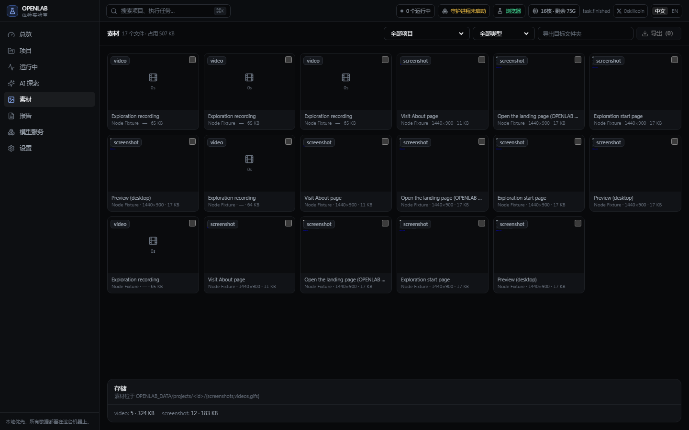
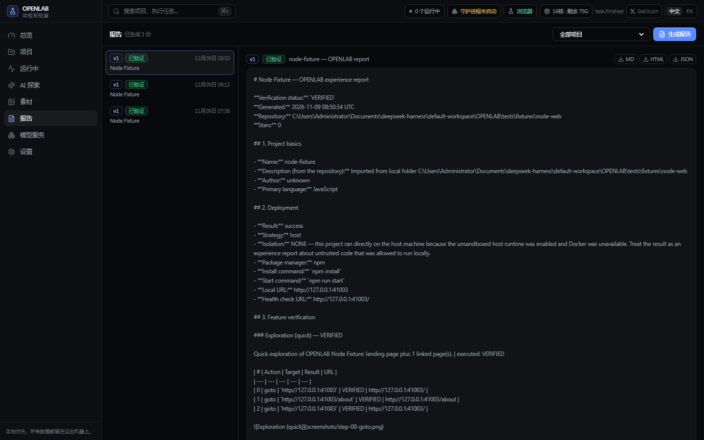
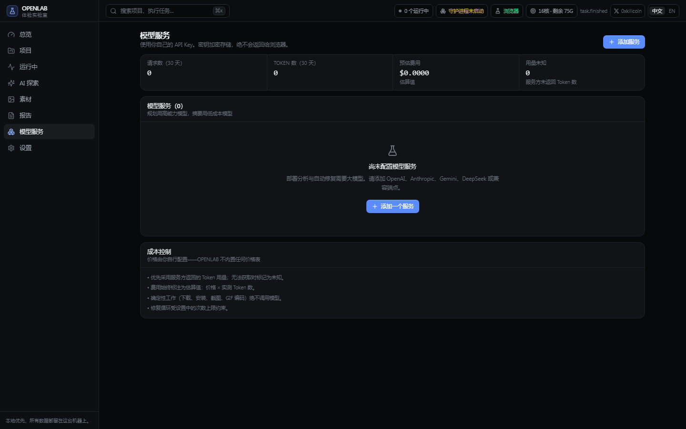
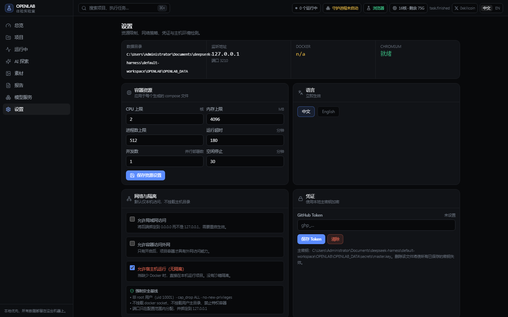

<div align="center">



# OPENLAB

**Open Source Project Experience Lab** · 开源项目体验实验室

把开源项目**真正跑起来**，再写体验报告

[](LICENSE)
[](requirements.txt)
[](apps/backend)
[](apps/web)
[](apps/desktop)
[](engine/browser_automation)
[](engine/docker_manager)
[](#测试)
[](#界面语言)

**[功能](#功能) · [界面](#界面) · [快速开始](#快速开始) · [架构](#架构) · [v0.1.1 修复](#v011-修复了什么) · [测试](#测试) · [FAQ](#faq)**

作者 [**0xkillcoin**](https://x.com/0xkillcoin) · [𝕏](https://x.com/0xkillcoin)

</div>

---

## 这是什么

OPENLAB 是一个**本地优先**的开源项目自动部署、真实体验、自动测试与素材采集工作台。

每天发现一个 GitHub 项目想写篇介绍文章，但你不想为了几张图去装一堆 Node、Python、数据库；也不确定 README 里写的功能到底能不能用。

OPENLAB 把这件事变成一条流水线：

```
仓库地址 → 源码分析 → 生成运行方案 → Docker 部署 → HTTP 健康检查
        → 浏览器真实探索 → 截图 / 录屏 / GIF → 体验报告
```

**它不是** GitHub 导航站、代码阅读器、AI 聊天网站或通用 IDE。
**它是**一台"体验机器"：所有结论背后都必须有真实容器、真实 HTTP 响应和真实浏览器会话。

> [!IMPORTANT]
> 项目源码、运行环境、日志、截图、视频与报告**默认全部保存在你自己的电脑上**。
> 使用你自己的大模型 API，不捆绑任何收费服务，不依赖云端 Sandbox。本地服务只监听 `127.0.0.1`。

---

## 核心原则

| 原则 | 落地方式 |
| --- | --- |
| **真实结果优先** | 只有容器真的起来、HTTP 真的返回、浏览器真的打开，才会被标记为 `RUNNING` |
| **确定性工作不烧 Token** | 下载、解包、装依赖、起容器、健康检查、截图、编码全由程序完成；模型只做规划与复杂排错 |
| **原项目优先** | 原始源码存于 `source/` 永不修改；AI 只写 `workspace/`，每次改动生成 diff 并记录原因，随时可回滚 |
| **不承诺都能跑** | 遇到 GPU、特殊系统依赖、外部 API 或授权限制，明确说明原因与所需条件 |
| **默认安全** | 第三方源码一律视为不可信代码：容器非 root、丢弃全部 capability、不挂载 Docker Socket |
| **不美化失败** | 缺 Docker、需要 GPU、多服务栈、编译型项目 —— 一律如实报 `WAITING_FOR_USER`，绝不假装成功 |

---

## 功能

### 📥 导入

- 公开 GitHub 链接、**私有仓库**（用你自己的 Token）、ZIP 上传、**本地文件夹**
- 自动获取仓库名称、描述、作者、默认分支、Star、License、更新时间、README 与源码
- 解包前检查路径穿越、绝对路径、软链接、文件数量与解压体积（防压缩炸弹）
- 不需要本机安装 `git` —— 走 GitHub codeload 的 ZIP 接口

### 🔍 分析

全自动，不需要你先读 README。会检查并解析：

`README.md` · `package.json` · 各类 lock 文件 · `pyproject.toml` · `requirements.txt` · `Dockerfile` · `docker-compose.yml` / `compose.yaml` · `Makefile` · `Cargo.toml` · `go.mod` · `.env.example` · `.nvmrc` · `.python-version` · `CMakeLists.txt` · `pom.xml` · `build.gradle` · `global.json` …

推断出语言与框架、包管理器、运行时版本、安装/构建/启动命令、端口与健康检查路径、Docker 配置、数据库与 Redis 等服务依赖、环境变量、GPU 要求、外部 API 需求，以及**每个结论来自哪个文件、置信度多少**。

### 🐳 部署

- 优先使用项目自带的 `Dockerfile` / `compose`，没有才根据源码生成
- 生成的文件永远包含安全基线：

```yaml
deploy:
  resources:
    limits: { cpus: "2.0", memory: 4096M }
pids_limit: 512
security_opt: ["no-new-privileges:true"]
cap_drop: ["ALL"]
privileged: false
# 端口只绑 127.0.0.1，来自保留区间 41000-41999
```

- 仓库自带的 compose 会先过**策略守卫**：特权容器、Docker Socket 挂载、主机目录挂载、host 网络/命名空间共享 —— 直接拒绝并说明
- 状态严格流转：`PENDING → ANALYZING → PLANNING → PREPARING → INSTALLING → BUILDING → STARTING → HEALTH_CHECK → RUNNING`

### 🩺 自愈（有上限）

失败时才启动，且永远基于真实日志：

1. 收集真实错误输出 → 2. 定位最相关的源码与配置 → 3. 模型生成最小补丁 → 4. 应用到**隔离的 workspace** → 5. 只重试失败的那一步 → 6. 记录 diff 与原因

默认最多 3 次，之后停下等你处理。**禁止无限重试，禁止修改宿主机配置。**

### 🌐 真实浏览器体验

- 项目启动后自动检查 HTTP 响应、启动本地 Chromium、访问真实页面
- 检查页面加载、标题、控制台错误与网络错误，自动生成首页截图
- 支持桌面 / 平板 / 手机三种视口
- 需要登录时，允许你**手动**在带界面的浏览器里登录并保存独立会话（不绕过认证）

### 🤖 AI 自动探索

| 模式 | 行为 |
| --- | --- |
| **Quick** | 快速识别主要页面，生成首页与核心页面截图 |
| **Deep** | 逐页探索，执行安全的主要交互并验证 |
| **Custom** | 用自然语言描述目标，例如"体验图片生成、下载和历史记录功能" |

方案会**对照真实 DOM 校验**：未知动作、跨域跳转、页面上不存在的选择器一律拒绝；支付、删除数据、发送邮件、发布内容、退出登录等危险操作（中英双语黑名单）永不自动点击。

### 🎨 素材中心

- **截图**：首页 / 整页 / 指定区域、操作前后对比；桌面 / 手机 / 平板；16:9、4:3、1:1、3:4 及自定义比例
- **视频**：完整操作录制、单功能演示、自定义时长、自动封面、压缩裁剪转码，支持 MP4 / WebM
- **GIF**：视频转 GIF，可设起止时间、FPS、尺寸与文件大小上限，自动多轮压缩
- **管理**：按项目分类，显示缩略图、文件名、类型、分辨率、大小、时间，支持预览、下载、删除、重命名、批量选择与导出
- 素材**真实写入本地文件**，不存在浏览器缓存里

### 📄 体验报告

每个项目独立报告，包含基础信息、部署信息、功能体验、技术分析、实际评价。

状态只有五种，且由真实证据决定：

`VERIFIED` · `PARTIALLY VERIFIED` · `UNVERIFIED` · `FAILED` · `BLOCKED`

支持 **Markdown / HTML / JSON** 导出。报告生成逻辑里写死了：README 的宣传语永远不会被当成验证结论。

### 💰 模型与成本

- 支持 OpenAI、Anthropic、Google Gemini、DeepSeek、任意 **OpenAI 兼容端点**（含本地 Ollama）
- 三种接口格式各有适配层（`openai-chat` / `anthropic-messages` / `gemini-generate`），不假设各家工具调用格式一致
- 连通性测试、模型切换、任务分配（复杂分析用高能力模型，分类摘要用低成本模型）
- 逐次记录 Token、请求数、延迟与**估算**费用；拿不到真实用量时明确标为"未知"
- 密钥用本机主密钥加密（`OPENLAB_DATA/secrets/master.key`），**永不返回给前端**，日志与报告自动脱敏

### 🗂 环境快照与任务调度

- 保存环境配置、compose、AI 修改补丁、启动命令、端口、变量名、浏览器测试任务 —— **快照绝不存明文 API Key**
- 停止、恢复、重新构建、删除容器、保留素材、删除全部数据
- 多项目排队、取消、暂停、恢复、重试；状态持久化，**重启后自动恢复**
- 默认并发 1，可调整

---

## 界面

> 以下截图全部由 OPENLAB 自己的 Playwright 流水线在运行中的工作台上拍摄，不是设计稿。
> 重新生成：`python scripts/capture-ui-screenshots.py`

### 总览


### 项目列表



### 项目工作区 — 可调整大小的多面板

上半屏是**真实项目预览**（可切桌面/平板/手机、一键截图），下半屏是 7 个面板：



| 面板 | 内容 |
| --- | --- |
| **Terminal** | 真实任务日志 + 在容器内执行 `docker exec` |
| **Logs** | 构建 / 运行 / 浏览器日志，从真实文件流式读取 |
| **Explorer** | 工作区文件树与源码预览 |
| **AI Agent** | 运行方案、判断依据、修复补丁与 Diff |
| **Assets** | 截图 / 视频 / GIF |
| **Report** | 体验报告 |
| **Snapshots** | 环境快照与一键恢复 |

### 运行中



### AI 探索



### 素材中心



### 报告



### 模型服务



### 设置



---

## 界面语言

整个工作台**默认中文**，中英双语完整覆盖（511 个词条 / 1022 条译文）。

- 顶栏右上角「中文 / EN」一键切换，或从 **设置 → 语言** 切换
- 选择保存在 `localStorage`（`openlab.locale`），刷新后保持；`<html lang>` 同步更新
- 状态名（`RUNNING`、`WAITING_FOR_USER`、`VERIFIED` …）由 `StatusBadge` 统一翻译，不会出现同一状态在不同页面写法不一致

---

## 快速开始

### 前置要求

| 组件 | 版本 | 用途 |
| --- | --- | --- |
| Python | 3.12+ | 后端（必需） |
| Node.js | 18+ | 构建前端 / 桌面端 |
| **Docker** | Desktop 或 Engine | **部署项目必需**（强烈推荐） |
| Playwright Chromium | 脚本自动安装 | 预览、截图、探索 |
| FFmpeg | 任意近期版本 | MP4 / GIF 导出（Playwright 自带精简版） |
| Rust | 1.77+ | 仅打包桌面安装包需要 |

检查本机环境：

```powershell
# Windows
powershell -ExecutionPolicy Bypass -File .\scripts\check-deps.ps1
```
```bash
# macOS / Linux
./scripts/check-deps.sh
```

### Windows

```powershell
git clone https://github.com/iiiiiiiiiiiiiKK/openlab
cd openlab
powershell -ExecutionPolicy Bypass -File .\scripts\openlab-start.ps1
```

脚本会：建虚拟环境 → 装 Python 依赖 → 装 Playwright Chromium → 构建前端 → 检测环境 → 启动后端并打开浏览器。

```powershell
.\scripts\openlab-start.ps1 -Port 3300 -NoBrowser   # 换端口 / 不自动开浏览器
.\scripts\openlab-start.ps1 -SkipWeb                # 只起后端
.\scripts\openlab-stop.ps1                          # 停后端 + 清理容器
```

### macOS / Linux

```bash
git clone https://github.com/iiiiiiiiiiiiiKK/openlab
cd openlab
chmod +x scripts/*.sh
./scripts/openlab-start.sh
./scripts/openlab-stop.sh          # 或 --keep-containers
```

### 手动安装

```bash
python -m venv .venv
# Windows: .venv\Scripts\activate
# macOS:   source .venv/bin/activate
pip install -r requirements-dev.txt
python -m playwright install chromium

cd apps/web && npm install && npm run build && cd ../..

# Windows
set PYTHONPATH=%CD%;%CD%\apps\backend
python -m openlab --port 3210 --open
```
```bash
# macOS / Linux
export PYTHONPATH="$PWD:$PWD/apps/backend"
python -m openlab --port 3210 --open
```

打开 <http://127.0.0.1:3210>。

### 桌面模式（Tauri 2）

```bash
cd apps/desktop
npm install
npm run tauri dev      # 开发
npm run tauri build    # 打包：Windows 出 MSI/NSIS，macOS 出 DMG
```

桌面壳会拉起后端、等 `/api/health` 通过再显示窗口，退出时结束后端进程。两种模式共用同一个数据库与数据目录。

---

## 第一次完整走一遍

1. **导入** — 总览页 →「从 GitHub 导入」，粘贴一个仓库地址，例如 `sindresorhus/slugify`（私有仓库在同一弹窗填 Token）
2. **看方案** — 自动跳到项目页，显示识别出的技术栈、安装/构建/启动命令、端口、环境变量、置信度，每项都标了来源文件
3. **部署** — 点「部署」，日志页实时滚动真实输出。成功则变绿显示访问地址；失败则收集真实日志、生成补丁并只重试失败的那一步
4. **预览** — 上半屏就是真实项目页面，可切视口、可一键截图（直接存进项目素材）
5. **探索** — AI 探索页选 Quick / Deep / Custom，跑一次真实操作
6. **素材** — 一键采集：首页 + 手机 + 平板 + 操作视频 + GIF
7. **报告** — 生成报告，导出 Markdown / HTML / JSON

---

## 架构

```
OPENLAB/
├── apps/
│   ├── backend/            FastAPI 应用、路由、服务、数据模型
│   │   └── openlab/
│   │       ├── app.py          应用工厂、WebSocket 总线、静态页托管
│   │       ├── models.py       17 张 SQLAlchemy 表
│   │       ├── db.py           引擎 + SQL 迁移执行器
│   │       ├── handlers.py     任务处理器（deploy / explore / assets / report）
│   │       ├── routers/        9 个路由模块
│   │       └── services/       编排：导入、部署、探索、报告、生命周期
│   ├── desktop/            Tauri 2 桌面壳（Rust）
│   └── web/                React + TS + Vite + Tailwind
├── engine/                 确定性引擎（不依赖 FastAPI，可独立单测）
│   ├── core/               路径、子进程、加密与脱敏、状态机
│   ├── project_importer/   URL 解析、安全解包、GitHub 下载
│   ├── project_analyzer/   树扫描、清单解析、运行方案
│   ├── docker_manager/     CLI 封装、Dockerfile/compose 生成、策略守卫、健康检查
│   ├── task_scheduler/     持久化队列：取消 / 暂停 / 恢复 / 重试 / 重启重排
│   ├── ai_agent/           三种接口适配、用量计费、补丁、修复循环
│   ├── browser_automation/ Chromium 启动、DOM 检查、截图、方案生成与执行
│   ├── media_processor/    FFmpeg 能力探测、转码、裁剪、封面、GIF
│   ├── asset_manager/      素材文件与数据库记录
│   ├── report_generator/   Markdown / HTML / JSON 渲染
│   └── runtime/            显式开启的无沙箱宿主机执行
├── packages/               types / shared / ui
├── migrations/             SQL 迁移（0001_init.sql …）
├── tests/                  unit / integration / e2e / fixtures
├── site/                   GitHub Pages 静态介绍页
├── docs/                   架构、安装、安全、测试、状态、截图
└── scripts/                Windows 与 macOS 的启动、停止、检查、验收脚本
```

### 数据流

```
┌────────────────────────────────────────────────────────────────┐
│ apps/web (React 18)                      apps/desktop (Tauri 2) │
└──────────────────────────┬─────────────────────────────────────┘
                           │ HTTP + WebSocket (127.0.0.1:3210)
┌──────────────────────────▼─────────────────────────────────────┐
│ apps/backend (FastAPI / SQLite-WAL / 进程内事件总线)            │
└──────────────────────────┬─────────────────────────────────────┘
                           │ 普通 Python 导入（没有 HTTP）
┌──────────────────────────▼─────────────────────────────────────┐
│ engine/（确定性，可单测，零 Web 依赖）                           │
└────────────────────────────────────────────────────────────────┘
```

设计规则：

1. **确定性的活儿由代码完成。** 下载、解包、安装、健康检查、截图、编码从不调用模型。
2. **模型只规划与修复。** 而且它的输出必须通过真实文件或真实 DOM 的校验。
3. **原始源码永不修改。** `source/` 保持纯净，AI 只写 `workspace/`，每次改动都有 diff 与备份。

详细设计见 [`docs/ARCHITECTURE.md`](docs/ARCHITECTURE.md)。

---

## 数据目录

```
OPENLAB_DATA/
├── openlab.db                 SQLite 数据库（WAL）
├── secrets/master.key         本机加密主密钥（API Key / Token）
├── browsers/                  Playwright 浏览器
├── tmp/                       子进程临时目录 / Playwright 工件
├── preserved/                 删除项目时保留的素材与报告包
└── projects/<project-id>/
    ├── source/                原始源码（只读）
    ├── workspace/             唯一允许 AI 修改的目录
    ├── docker/                生成的 Dockerfile 与 compose
    ├── logs/                  deploy.log / host-install.log / host-runtime.log
    ├── screenshots/  videos/  gifs/
    ├── reports/               report-v1.md / .html / .json
    ├── patches/               每次修复的 diff 与备份
    └── metadata.json          导入元数据 + 分析快照
```

用 `OPENLAB_DATA_DIR` 可以把整个目录搬到别的磁盘。

---

## 安全

第三方源码全部视为**不可信代码**。

| 威胁 | 缓解措施 |
| --- | --- |
| 恶意压缩包 | 解包前检查路径穿越、绝对路径、软链接、文件数量、解压体积 |
| 恶意项目 | 容器隔离、非 root、`cap_drop: ALL`、资源限额、无主机挂载、无 Socket、默认禁外网 |
| 凭证泄露 | 本机主密钥加密存储；日志、事件、报告、API 响应全部脱敏 |
| 端口/主机接管 | 保留端口区间，只绑定 `127.0.0.1` |
| 不安全的自动化 | 方案对照真实 DOM 校验 + 危险操作黑名单（中英双语） |
| 静默降级 | 无沙箱的宿主机模式必须显式开启，且处处标注 |

完整威胁模型见 [`docs/SECURITY.md`](docs/SECURITY.md)。

---

## v0.1.1 修复了什么

这一版是一次"证据完整性 + 可用性"的整改。因为 OPENLAB 的卖点是 **所有结论背后都有真实证据**，所以下面这些缺陷属于产品红线，不是小修小补。

### 会弄坏真实数据

| 缺陷 | 修复 |
| --- | --- |
| 生成的 compose 用 `build.context: ..`，让 Docker 去构建**项目根目录**（里面有 `source/`、`screenshots/`、上次的构建产物），`COPY . /app` 根本拿不到应用代码 | 改成指向 `workspace/`，由 `deploy._build_context_relpath()` 计算相对路径 |
| AI 修复只把源文件**截到 12000 字符**发给模型，却要求它"返回完整文件内容"，结果把真实源码截断写回 | 超过 `MAX_EDITABLE_FILE_BYTES` 的文件直接跳过，绝不截断 |
| 统一 diff 的上下文行不做比对，直接把该位置覆盖掉，上下文对不上的补丁也"应用成功"并写坏文件 | 上下文行严格比对，不匹配抛 `PatchError` |
| `apply_patch` 逐个文件写，中途失败时已写的文件不回滚，下一轮在残缺代码树上继续改 | 全有或全无，失败自动回滚 |
| 删除项目时对 `data_dir` 字段直接 `rmtree`，没有任何包含性校验 | 只允许删 `OPENLAB_DATA/projects/` 之下的路径 |
| 同名项目共用容器/网络名，导入同一个仓库两次后，部署 B 会把 A 的容器拆掉 | 容器名与网络名带上项目 id |

### 会编造结果（触碰产品红线）

| 缺陷 | 修复 |
| --- | --- |
| 探索步骤的初始状态就是 `VERIFIED`，`goto` 丢掉 HTTP 响应 —— 404 页面和空 `wait` 都会被报成"已验证体验" | 初始 `UNVERIFIED`，只有 `goto`/`click`/`fill`/`press`/`hover`/`check`/`select` 能升级状态，`goto` 遇到 ≥400 直接 `FAILED` |
| 全是被动步骤的探索也能汇总成 `VERIFIED` | 至少要有一个真正 `VERIFIED` 的步骤才可能汇总为 `VERIFIED` |
| 控制台/网络错误跨步骤累积，第 N 步继承了前 N-1 步的错误 | 按步骤边界归属（`console_errors_since`） |
| 报告仅凭 `RUNNING` 标志就写"HTTP 健康检查通过（状态 200）" | 状态码当场探测；探测不到就如实写"启动后未响应探测" |
| `.md`、`.html`、`.json` 各自重算 payload，可能互相矛盾 | 三份产物共用同一份 payload |

### 会崩溃或卡死

| 缺陷 | 修复 |
| --- | --- |
| 系统里 `NO_PROXY` 含 `[::1]` 时，`httpx` 构造客户端就抛 `InvalidURL` —— GitHub 导入和所有模型调用全挂 | 新增 `engine/core/http.py`，统一净化并作为唯一客户端出口 |
| Playwright 找不到与版本匹配的 ffmpeg，创建录制页面时把整个浏览器会话打断 | 启动前探测；不可用时降级为无录屏并记录原因 |
| 无条件把 `PLAYWRIGHT_BROWSERS_PATH` 指向数据目录（即使里面是空的），把可用的全局安装屏蔽掉 | 只有数据目录里真有 Chromium 时才接管 |
| 浏览器启动失败会泄漏一个 Chromium + driver 进程（`__aenter__` 抛错时 `__aexit__` 不会执行） | `__aenter__` 失败即清理，`__aexit__` 幂等 |
| 用量/设置接口每次都新建 `AIClient` 且从不关闭 Session，连接池耗尽后整个 API 卡死 | 调用方一律 `try/finally: session.close()` |
| `Budget.consume()` 全仓无调用，请求数/Token/美元三道上限形同虚设 | `client.complete()` / `complete_json()` 接收并消费 budget |
| 模型回复不是合法 JSON 时抛 `ValueError`，直接崩掉部署任务 | 包装成 `ProviderError`，按普通修复失败处理 |
| 每一行输出都单独 commit 一次日志，长构建把事件循环按在 SQLite 写锁上 | 日志按批提交 |

### 任务调度语义

| 缺陷 | 修复 |
| --- | --- |
| 排队中被 pause 的任务，被 worker 取出后照样执行 | `_run` 跳过 `paused` |
| 对 paused 任务 cancel 只置标志位，状态永远停在 paused | queued/paused/waiting 直接取消 |
| cancel 取消的是 **worker 自身**（它被登记在 `_running` 里），后续所有排队任务卡死 | 每个任务跑在独立子任务里，worker 继续消费队列 |
| 取消处理器会覆盖 `resume()` 刚写回的 queued 状态，任务永久卡住 | 只降级仍处于 `running` 的行 |
| `resume()` 可能把同一个任务入队两次 | 入队去重 |
| `max_parallel_deployments` 只改配置不改 worker 数量 | 新增 `scheduler.set_concurrency()` |

### 设置与生命周期

| 缺陷 | 修复 |
| --- | --- |
| UI 改的设置只写进 `app_settings` 从不回读，重启后静默恢复默认 | 启动时 `_apply_persisted_settings()` 回填 |
| `STARTING` 到 `RUNNING`、`PENDING` 到 `PREPARING` 被判非法并静默强制写入 | 补进状态机；非法流转改为记日志而不是吞掉 |

每一类都补了回归用例，见 [`tests/unit/test_audit_regressions.py`](tests/unit/test_audit_regressions.py)。

---

## 测试

```bash
pytest tests/unit -q            # 纯逻辑，无外部依赖
pytest tests/integration -q     # 真实 FastAPI 应用 + 真实 SQLite
pytest tests/e2e -q             # 真实浏览器、真实子进程、有 Docker 时跑真实 compose
cd apps/web && npm test         # 前端：翻译目录与告警映射
```

**测试必须产出真凭实据。** 用 mock 冒充 Docker、浏览器或 FFmpeg 是明确禁止的 —— 依赖环境的用例会**带原因跳过**，而不是假装通过。

### 证据链的判定规则（v0.1.1 起）

浏览器探索的每一步都从 `UNVERIFIED` 开始，只有真正拿到证据才能升格：

| 动作 | 能得到的证据 | 最高状态 |
| --- | --- | --- |
| `goto` | 真实 HTTP 响应（4xx/5xx 直接判 `FAILED`） | `VERIFIED` |
| `click` / `fill` / `press` / `hover` / `check` / `select` | 控件真实存在并接受了交互 | `VERIFIED` |
| `wait` / `scroll` / `screenshot` | 什么都没证明 | `UNVERIFIED` |

控制台错误按**步骤边界**归属：第 N 步不会继承第 N−1 步的错误。整轮探索只有在每一步都是 `VERIFIED` 时才汇总为 `VERIFIED`，否则最多 `PARTIALLY_VERIFIED`，有失败步骤时为 `FAILED`。

报告里的 HTTP 状态码同样是**当场探测**出来的，不是从 `RUNNING` 状态推断的 —— 探测不到就写「启动后未响应探测」，不会编一个 `200`。

本机（Windows 10，无 Docker、无 Rust）实测全部三条命令：

```
pytest tests/unit tests/integration → 191 passed, 1 skipped
pytest tests/e2e                    →   6 passed, 2 skipped
pytest（全量）                       → 206 passed, 5 skipped
apps/web npm test                   →  15 passed
```

跳过原因会打印出来，例如：

```
SKIPPED  this ffmpeg build has no H.264/mp4 support (missing: an H.264 encoder (libx264), the mp4 muxer)
SKIPPED  Docker daemon is not available on this host
```

### 端到端验证脚本

不跑 pytest 也能验收核心链路：

```bash
python scripts/verify-core-loop.py                      # 本地 fixture 项目
python scripts/verify-core-loop.py --github owner/repo  # 顺带导入一个真实仓库
```

输出示例：

```
RUNNING on http://127.0.0.1:41000 (HTTP 200)
title='OPENLAB Node Fixture'   exploration=VERIFIED (3 steps)
assets: 4 screenshots, 1 video  report: VERIFIED
```

详见 [`docs/TESTING.md`](docs/TESTING.md)。

---

## 它做不到什么

一个只会报成功的工具没有价值。以下情况 OPENLAB 会**停下并说明具体原因**：

| 情况 | 行为 |
| --- | --- |
| **编译型 / 桌面项目**（`.sln`、CMake、Bazel、JVM 桌面、.NET 桌面、Windows 壳扩展） | 识别为 `native`，部署返回具体信号（如「检测到 Visual Studio 解决方案」），不生成虚假体验报告；源码分析与技术章节仍然可用 |
| **没有 Docker** | 停在 `WAITING_FOR_USER` 并给出安装指引；可显式开启无隔离的宿主机模式，但界面、数据库、报告处处标注「未沙箱化」 |
| **多服务栈**（compose + 数据库） | 无 Docker 时直接拒绝，而不是只起一个 web 进程就说成功 —— 那样应用其实连不上数据库 |
| **需要 GPU / 特殊驱动** | 明确列出检测到的证据与所需条件 |
| **缺少 API Key** | 逐个变量标出是否已配置，报告中标记 `BLOCKED` |
| **精简版 FFmpeg** | WebM ✅、GIF 走「抽帧 + Pillow 合成」兜底 ✅、MP4 返回 `409` 并说明缺哪个编码器 |

---

## FAQ

<details>
<summary><b>需要联网吗？</b></summary>

只有从 GitHub 导入和调用你自己配置的大模型时需要。导入后源码、部署、截图、报告全部本地完成。
</details>

<details>
<summary><b>AI 是必需的吗？</b></summary>

不是。导入、分析、部署、健康检查、截图、录屏、GIF、报告**全部不需要模型**。只有"方案微调"和"失败自动修复"需要。
</details>

<details>
<summary><b>支持私有仓库吗？</b></summary>

支持。在导入弹窗填入 GitHub Token，或到「设置 → 凭证」保存。Token 只被本地后端使用，加密存储，绝不发送到浏览器。
</details>

<details>
<summary><b>能在 GitHub Pages / Vercel / Cloudflare 上部署本体吗？</b></summary>

**不能。** OPENLAB 需要真实的 Docker 守护进程、本机 Chromium 与 FFmpeg，是一个本地优先的桌面工具。
本仓库的 Pages 站点只是这个静态介绍页。
</details>

<details>
<summary><b>Windows 上提示脚本无法运行？</b></summary>

PowerShell 默认禁止未签名脚本。用 `powershell -ExecutionPolicy Bypass -File .\scripts\openlab-start.ps1`，或先执行 `Set-ExecutionPolicy -Scope Process RemoteSigned`。
</details>

<details>
<summary><b>提示无法启动 Chromium？</b></summary>

运行 `python -m playwright install chromium ffmpeg`。两个都要装：Playwright 在创建「录制中」的页面时会校验它自己的 ffmpeg 构建，缺了会让整个浏览器会话断开（不只是录不到视频）。OPENLAB 会在启动前探测并降级为无录屏模式，同时在任务日志里写明原因。如果账户对 `%TEMP%` 没有写权限，把 `OPENLAB_DATA_DIR` 指到可写目录 —— OPENLAB 会自动把浏览器工件目录放进数据目录。
</details>

<details>
<summary><b>预览窗口是空白的？</b></summary>

目标项目可能设置了 `X-Frame-Options: DENY` 或严格 CSP。用预览工具栏的「在新标签页打开」，截图与探索不受影响。
</details>

<details>
<summary><b>端口冲突？</b></summary>

默认使用 41000–41999。可在 `.env` 里改 `OPENLAB_PORT_RANGE_START` / `OPENLAB_PORT_RANGE_END`，或在运行页停掉不用的项目。
</details>

<details>
<summary><b>素材在哪里？</b></summary>

`OPENLAB_DATA/projects/<project-id>/screenshots|videos|gifs`，或在素材页直接「导出」到任意目录。
</details>

---

## 贡献

欢迎 Issue 与 PR。请先看 [CONTRIBUTING.md](CONTRIBUTING.md) —— 里面写了代码规范、模块边界，以及最重要的测试期望：**mock 出来的成功不算成功**。

## 许可证

[MIT](LICENSE) © 2026 0xkillcoin

---

<div align="center">

**[𝕏 @0xkillcoin](https://x.com/0xkillcoin)** · [GitHub](https://github.com/iiiiiiiiiiiiiKK) · [报告问题](https://github.com/iiiiiiiiiiiiiKK/openlab/issues)

<sub>用 Python · React · Docker · Playwright · FFmpeg 构建</sub>

<sub>本地优先。所有数据都留在这台机器上。</sub>

</div>
